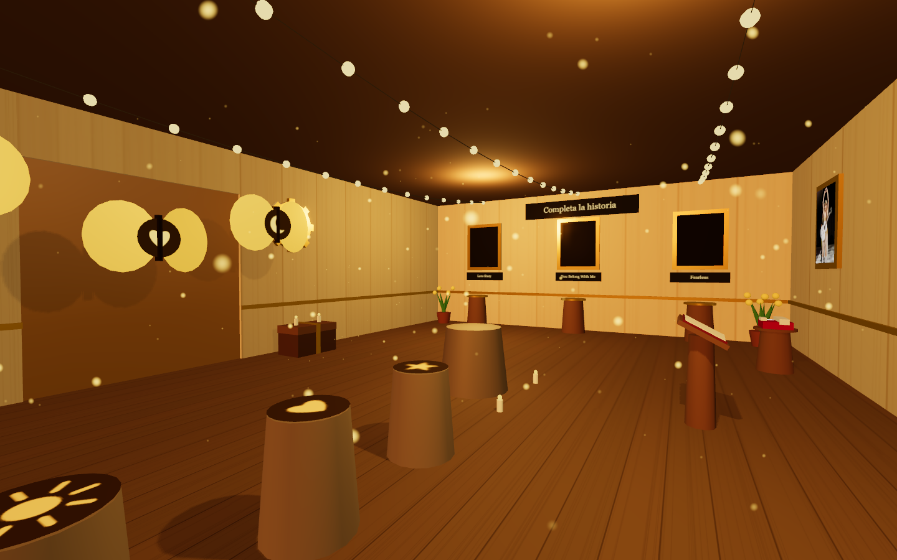
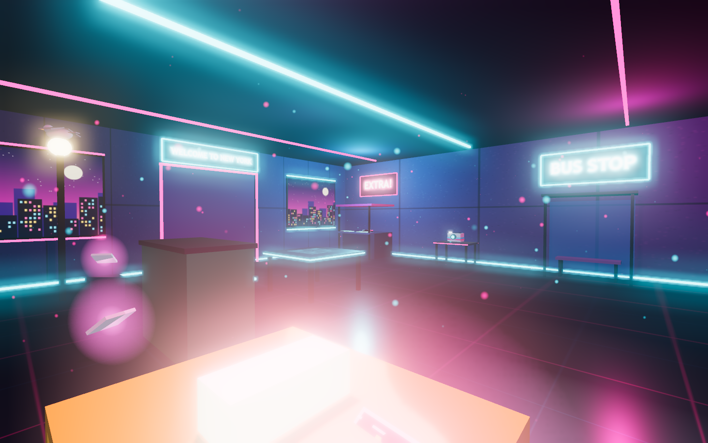
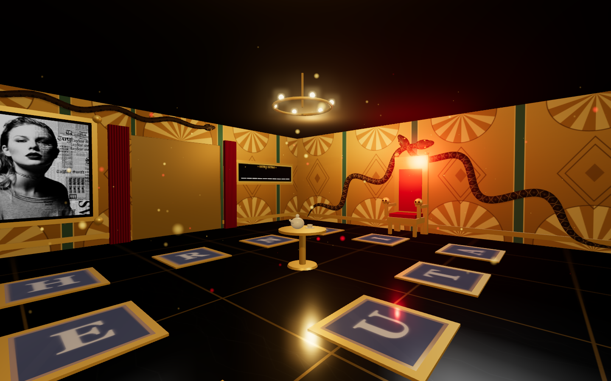
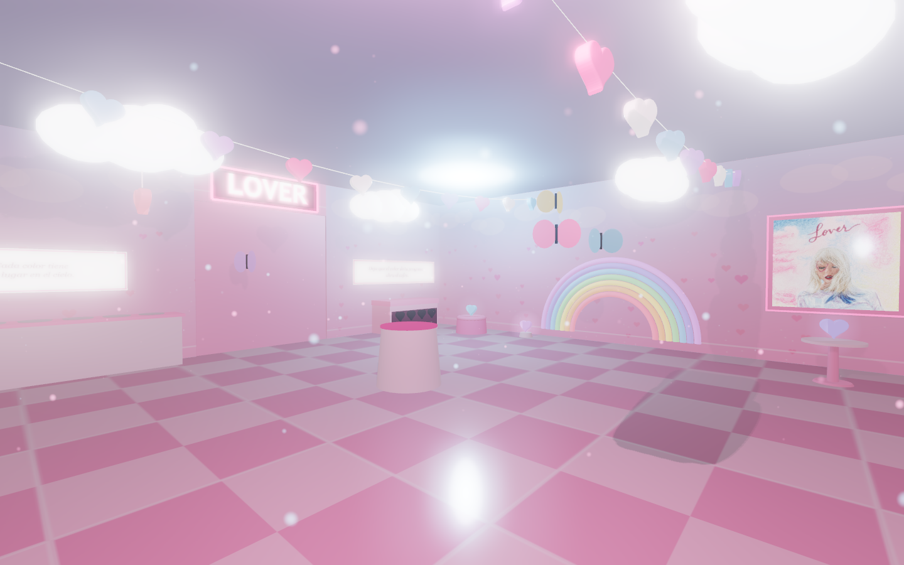
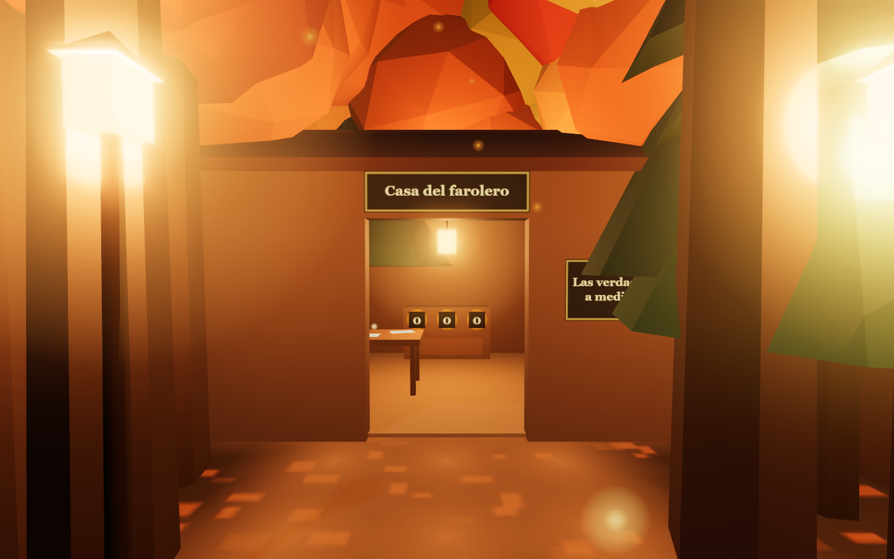
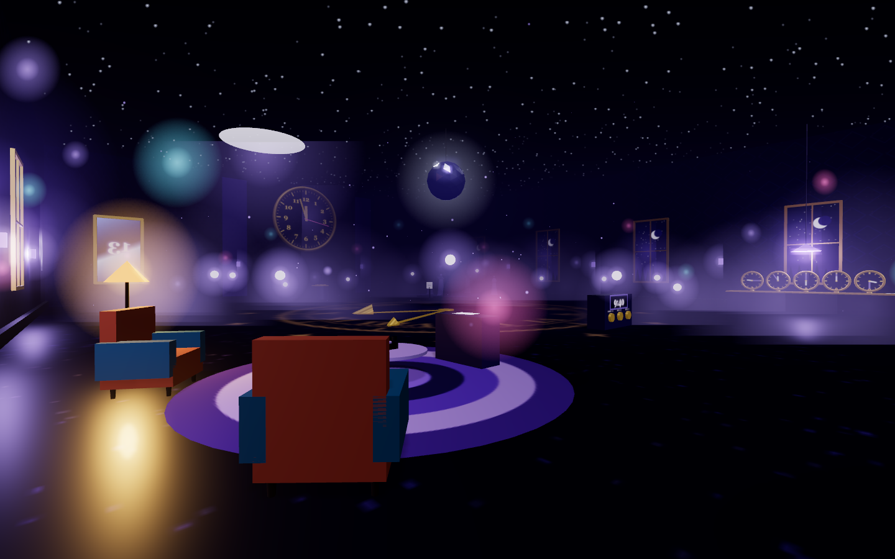
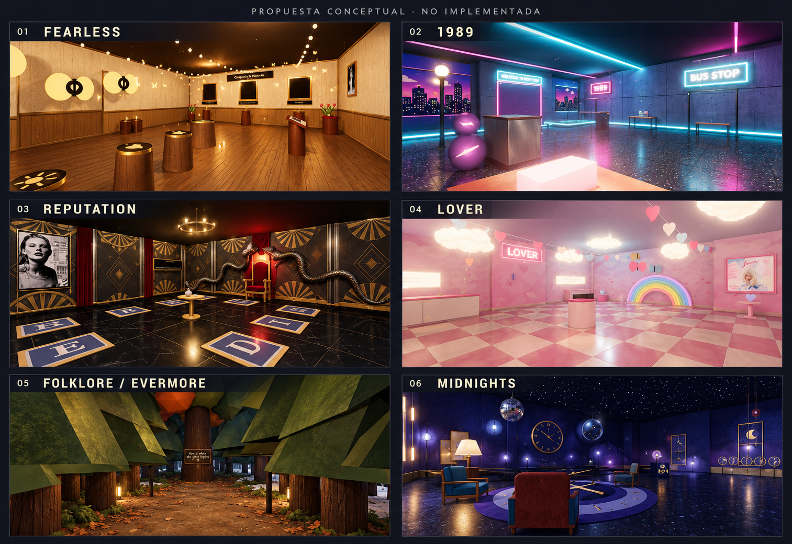

# Propuesta de retexturizado — The Eras Escape

Fecha: 1 de noviembre de 2026. Basada en 18 capturas nuevas del juego local: entrada, diagonal y contraplano de cada una de sus seis salas. Las capturas usan la escena, iluminación y posprocesado actuales, sin sustituir materiales. La cámara se posicionó para inspección; no constituye una prueba de recorrido ni de resolución de acertijos.

## Dirección recomendada

**Seis eras, seis familias de materiales, una misma calidad artesanal.** Mantener el estilo de cuento y la geometría sencilla del juego; sumar textura creíble a escala humana, desgaste discreto y contraste entre superficies mates y brillantes. Buscar un resultado estilizado y táctil, compatible con los objetos actuales.

La separación principal sería: Fearless cálida y dorada; 1989 urbana y fría; Reputation oscura y metálica; Lover pastel y cerámica; Folklore/Evermore orgánica y estacional; Midnights azul tinta y textil.

## Alcance

Retexturizar paredes, pisos, techos y objetos existentes. Conservar distribución, colisiones, objetos, imágenes de álbumes, textos, símbolos y reglas de los acertijos. La lámina generada, si se incluye, es una interpretación conceptual y no un render implementado.

Las capturas también muestran resplandores fuertes en 1989 y Lover. Ajustar localmente esas emisiones sería una tarea complementaria: cambiar texturas no basta para recuperar detalle en zonas sobreexpuestas. Evitar cambios globales de exposición que alteren todas las salas.

## 1. Fearless — Un cuento dorado con materiales cálidos

**Lo observado.** Paredes amarillas con líneas verticales, piso de tablas, techo marrón y pedestales casi del mismo tono. La luz y las partículas ya construyen la atmósfera; falta separar los materiales.

**Paredes.** Lino marfil o papel de fibra fina, conservando la división horizontal. Bajo ella, madera miel de veta suave.

**Piso.** Roble cálido con tablas reconocibles, variación leve y juntas finas. Acabado mate, sin manchas que parezcan pistas.

**Objetos.** Latón cepillado en marcos y remates; madera más oscura en cofres; cuero granate y papel crema en el libro. Discos de símbolos limpios y contrastados.

**Conservar.** Mariposas, guirnaldas, libro central y posiciones de los tres pedestales.

**Prioridad.** Piloto recomendado: permite fijar escala de texturas y contraste entre madera, papel y metal.

**Paleta orientativa:** #ead9b8, #a47342, #b38a43, #49301f.

## 2. 1989 — Nueva York: esmalte, concreto y neón

**Lo observado.** Paneles azulados, ciudad ilustrada en ventanas, líneas rosa y cian y piso oscuro cuadriculado. El brillo intenso de algunos objetos aplana sus detalles.

**Paredes.** Concreto fino azul grisáceo y paneles de esmalte satinado. Mantener los marcos, ventanas y dibujos de ciudad existentes.

**Piso.** Baldosas de terrazo grafito con grano pequeño y juntas discretas. Reflejos suaves; dejar el brillo más fuerte para el metal y el vidrio.

**Objetos.** Acero cepillado en parada y farola; pintura esmaltada en banco y cámara; papel realista en recortes. Neón cian y rosa como acento.

**Conservar.** Skyline, carteles, parada de bus y piezas de los acertijos.

**Prioridad.** Segunda pasada: contrastar materiales fríos con la sala cálida de Fearless.

**Paleta orientativa:** #243544, #a5c8d5, #ec76ad, #d7d8d0.

## 3. Reputation — Salón oscuro de poder y prensa

**Lo observado.** Grandes abanicos dorados y franjas verdes dominan las paredes; piso negro con retícula dorada, trono rojo y espejos con letras. Se lee más dorada que oscura.

**Paredes.** Conservar el dibujo art déco, pero convertir el fondo en carbón y los abanicos en dorado viejo de bajo contraste. Filetes de peltre en lugar de verde saturado.

**Piso.** Piedra negra satinada, veta muy escasa y juntas atenuadas. Los espejos con letras deben destacar sobre la piedra.

**Objetos.** Terciopelo vino en trono y cortinas, metal envejecido en estructura, serpientes de plata oscura con escamas finas. Periódicos marfil y negro con textura de tinta.

**Conservar.** Todos los espejos, letras, estados de acierto/error y superficie del espejo que se rompe.

**Prioridad.** Mayor cambio de identidad: separar esta sala del dorado de Fearless sin reemplazar su arquitectura.

**Paleta orientativa:** #171a1e, #a9adb0, #a68a49, #741f2e.

## 4. Lover — Una caja de recuerdos en tonos pastel

**Lo observado.** Damero rosa y blanco, paredes con corazones, arcoíris y nubes luminosas. El velo blanco y el brillo reducen la lectura de carteles y superficies.

**Paredes.** Papel mate de rosa empolvado y celeste, con nubes de acuarela muy tenues. Reducir la densidad de corazones alrededor de carteles.

**Piso.** Conservar el damero, con baldosa cerámica satinada en rosa viejo y crema. Pequeña variación entre piezas, juntas cálidas y casi ningún reflejo puntual.

**Objetos.** Laca pastel en cofres y pedestales; detalles de nácar moderados. Corazones y arcoíris conservan exactamente sus colores de juego. Túnel con acabado de pintura sedosa.

**Conservar.** Orden y colores del acertijo, cofres, túnel de corazón, guirnaldas y arcoíris.

**Prioridad.** Texturas y contraste deben revisarse juntos: el acabado mate por sí solo no resuelve la luz que quema blancos.

**Paleta orientativa:** #e9b7cf, #dce7e8, #c3b5d9, #f0e6d6.

## 5. Folklore / Evermore — Bosque de cuento, tierra y estaciones

**Lo observado.** Árboles de geometría facetada, troncos lisos y suelo pintado con manchas amplias. La entrada ya diferencia la tierra cálida y la nieve del lado invernal.

**Paredes.** En el perímetro, manchas verticales suaves de bosque oscuro; evitar un patrón de ladrillos o bloques reconocibles. Conservar el cielo y la niebla.

**Piso.** Mezcla de tierra con hojas al oeste, musgo y tierra en el centro y nieve compactada al este. Bordes difuminados según los senderos existentes.

**Objetos.** Corteza vertical poco contrastada sobre troncos, madera de intemperie en la cabaña, hierro oscuro en faroles y hielo azulado en el lago. Mantener copas facetadas.

**Conservar.** Huellas, musgo que funciona como pista, rutas, cruces, nieblas, lago y símbolos de los faroles. No agregar huellas decorativas.

**Prioridad.** Primero suelo y troncos. La textura puede mejorar las superficies, pero no elimina la silueta geométrica de las copas.

**Paleta orientativa:** #354538, #826344, #c18043, #d4e0e7.

## 6. Midnights — Observatorio íntimo de medianoche

**Lo observado.** Espacio nocturno amplio con gran reloj inscrito en el piso, cielo estrellado, esfera reflectante y estaciones laterales. La decoración se concentra en azul, violeta y oro.

**Paredes.** Tejido jacquard azul tinta, con el rombo actual mucho más tenue. Detalles de latón envejecido y cortinas de terciopelo ciruela.

**Piso.** Piedra azul noche con grano fino, sin añadir vetas que compitan con el gran reloj. Conservar números, marcas y posición del anillo como capa independiente.

**Objetos.** Nogal oscuro para escritorio y muebles, tejido visible en alfombra y asientos, metal plateado para esfera y latón en relojes. Brillo selectivo en los objetos de interés.

**Conservar.** Cielo, reloj del suelo, relojes interactivos, tablero, constelaciones, portal y estados de los acertijos.

**Prioridad.** Revisión final: que el detalle material aparezca cerca y la lectura del reloj se mantenga desde la entrada.

**Paleta orientativa:** #141329, #343358, #a7a9c1, #ba9b55.

## Preparación de materiales

- Usar textura de color, relieve suave y variación de rugosidad donde aporten una diferencia visible. Papel, piedra, cerámica y madera no deben comportarse como metal.
- Preparar texturas repetibles de 1024 px; reservar 2048 px para superficies protagonistas cercanas si la prueba de rendimiento lo permite. Son objetivos de producción, no mediciones del juego.
- Ajustar la escala por material: tablas de unos 15–20 cm de ancho, baldosas de 40–60 cm y fibras de papel apenas visibles de cerca. Validar en la cámara real antes de extender el material.
- Reutilizar una pequeña biblioteca de madera, piedra, metal y tejido, con variantes por era. Mantener los materiales compartidos de árboles y otros objetos repetidos.
- Separar bases decorativas de letras, símbolos, huellas, colores y marcas de juego. Las nuevas texturas no deben inventar pistas ni ocultar las existentes.
- En el bosque, combinar la distribución actual de estaciones con detalle repetible; una sola imagen ampliada sobre todo el terreno pierde definición de cerca.

## Orden de ejecución propuesto

1. **Fearless como sala piloto:** pared, piso y un pedestal. Comparar las mismas tres cámaras antes/después y fijar el nivel de detalle.
2. **Reputation y Lover:** dar identidad oscura a la primera y recuperar contraste en la segunda. Revisar las letras y los colores de sus acertijos.
3. **1989 y Midnights:** introducir contraste entre piedra, metal, laca y tejido sin volver todo reflectante.
4. **Folklore/Evermore:** trabajar terreno y corteza por estación; revisar cada pista y transición de camino en un recorrido real.

## Criterios para considerar aprobada una sala

- Desde la entrada se reconoce la era y se identifica el objeto principal.
- A la distancia normal de interacción se leen textos, letras, símbolos y colores.
- No se ven costuras evidentes, estiramientos ni patrones repetidos demasiado grandes.
- Los materiales tienen una escala consistente y conservan detalle bajo la luz existente.
- Los cambios no introducen pistas falsas ni alteran estados visuales de los acertijos.
- Comparar rendimiento con las mismas cámaras y condiciones antes/después; todavía no se midió el costo de materiales nuevos.

## Entregables de esta revisión

- `capturas/`: 18 imágenes nuevas a 1440 × 900.
- `registro.json`: cámaras, límites de salas y errores de ejecución observados durante la captura.
- `estado-actual.jpg`: lámina de referencia con una captura de cada sala.
- `propuesta.html`: informe navegable con las tres vistas de cada sala y paletas.
- `propuesta.md`: este documento.

Esta entrega es una propuesta; no se aplicaron cambios al juego.

## Lámina conceptual

Generada con la herramienta integrada de imágenes a partir de la lámina de capturas actuales. Es una interpretación: algunos detalles y reflejos difieren del juego. Para producción prevalecen los materiales mates y satinados del informe; no se propone copiar los reflejos intensos de la lámina. Prompt completo en `prompt-concepto.md`.
